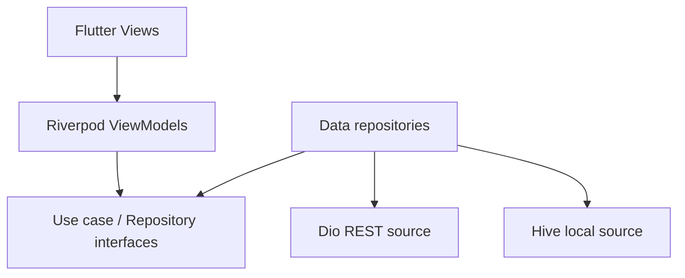

# Orbit — Flutter News Reader

A space news reader for the supplied Flutter Developer Assessment. Production data comes from the Spaceflight News API, never bundled article fixtures. The only mocked production feature is authentication, as allowed by the assessment.

## Start here

1. Install the **latest stable Flutter SDK** from https://docs.flutter.dev/install and configure Android Studio / Android SDK. These dependencies require **Dart 3.13 or newer**. Use `flutter channel stable`, `flutter upgrade`, and `flutter doctor` on your development machine.
2. Extract this project and open a terminal in `orbit_news`.
3. Run the setup below. Python 3 is required only for the cross-platform setup script.

```bash
python3 scripts/bootstrap.py
flutter analyze
flutter test
flutter run
```

On Windows, use `python` if `python3` is unavailable. The bootstrap script creates the standard Android/iOS platform folders using your installed Flutter SDK, grants Android internet permission, sets Android minSdk to at least 24, downloads pub dependencies, generates Freezed/JSON files, and formats source. It does not overwrite the application code. Once platform folders exist, it preserves them. Run this as normal project setup; no API key or source edits are required.

This source package was authored without a preinstalled Flutter or Android SDK. Read `VALIDATION.md` for the exact checks performed and remaining checks. Do not submit an unverified build to the assessor.

## API

- Provider: **Spaceflight News API (The Space Devs)**
- Website: https://www.spaceflightnewsapi.net/
- Official API documentation: https://api.spaceflightnewsapi.net/v4/docs/
- Schema: https://api.spaceflightnewsapi.net/v4/schema/
- No API key is configured or required by this implementation.
- Endpoint: `https://api.spaceflightnewsapi.net/v4/articles/`

Examples:

```text
GET /v4/articles/?limit=20&offset=0&ordering=-published_at
GET /v4/articles/?limit=20&offset=20&ordering=-published_at
GET /v4/articles/?limit=20&offset=0&ordering=-published_at&search=NASA
```

The adapter reads `count`, `next`, and `results`, then maps `id`, `title`, `url`, `image_url`, `news_site`, `summary`, and `published_at`. `search` searches article title/summary keywords on the server. Search is debounced by 400 ms. The remote offset advances by the raw result count before deduplication; pagination ends when `next` is null or no rows arrive. The server's `next` URL is not fetched directly.

**Scope assumption:** This is a space-news reader. The assignment does not prescribe a news category. This API returns summaries and publisher links, not full licensed article bodies. Saved summaries, titles, dates, and sources work offline. Full publisher articles require internet and open externally. Confirm with the assessor if they specifically require general/world news or entire article bodies offline; that would need another API and content rights. A free public API is not an availability SLA. Provider terms, rate limits, and publisher image availability can change.

## Architecture: Clean Architecture with MVVM presentation

MVVM and Clean Architecture work together here:

- **View:** Flutter screen/widget. Renders state and forwards user actions.
- **ViewModel:** Riverpod `Notifier` with immutable Freezed state. Owns loading, search, paging, validation/session flow, and bookmark activity.
- **Domain:** Pure Dart entities, small repository interfaces, and the `FetchNews` use case. No imports of Flutter, Dio, Hive, Riverpod, or DTOs.
- **Data:** REST/Hive implementations, DTO serialization, failure mapping, and cache behavior.
- **Composition:** `app/providers.dart` injects concrete implementations through interfaces. Tests replace providers with fakes.



SOLID mapping:

| Principle | Application |
|---|---|
| Single responsibility | Widgets render; ViewModels manage state; DTOs serialize; sources perform I/O. |
| Open/closed | A new API adapter or storage repository can implement the same domain contract. |
| Liskov substitution | Controlled test repositories and concrete repositories satisfy the same interfaces. |
| Interface segregation | Separate news, bookmarks, session, and preferences interfaces. |
| Dependency inversion | ViewModels consume interface providers; infrastructure is wired at the composition root. |

There is one meaningful news use case. Simple settings and bookmark commands call their narrow domain repository directly instead of adding classes that only forward one method.

## Feature behavior

### Authentication

Use any valid email address and an 8–72 character nonblank password. Email is trimmed and lowercased. Password is not trimmed or stored, logged, or sent to a server. There is no real credential verification. With Remember enabled, the email is restored after restart. Without Remember, the current in-memory session lasts until process termination. Logout clears the remembered identity and the route guard returns to login. The email acts as the local bookmark namespace; this is demo separation, not secure multi-user authentication.

### News and search

Infinite scrolling requests another page near the bottom. The fallback load-more button also works with keyboard or large screens. Pull-to-refresh refreshes the current query. Initial loading, refresh, page loading, API failure, page failure, empty results, and end-of-list have explicit UI. Existing articles remain visible when refresh or pagination fails. Retry repeats the failed offset. Search resets pagination; generation tokens ignore stale responses. Already-started API requests may finish, but cannot overwrite newer state. No automatic retry loop is used for API failures or rate limits.

### Offline support

- Hive stores the first page for up to 12 distinct normalized queries. A failed first-page network request can show that query's previous snapshot, clearly marked as an offline copy. A fresh live response replaces that query's snapshot.
- Snapshots are not time-limited; the notice explicitly warns they may be stale. They never pretend to support additional offline pages.
- Malformed API responses are displayed as invalid responses rather than silently replaced with cache. Network/timeout/server/rate-limit failures can use cache.
- Bookmarks store article metadata and summaries separately from the evictable feed cache.
- Bookmark images are best-effort: first persist the article, then attempt an image download with a 6-second overall deadline and 2 MiB limit. Successfully downloaded thumbnail bytes are in Hive, not only in an evictable image cache. If the image fails, saved text still works offline and a placeholder is shown.
- Regular feed images use `cached_network_image` with bounded decoded width. Their temporary cache is not the guarantee behind offline bookmarks.
- Corrupt feed cache records are ignored; corrupt individual bookmark records are skipped. Storage write failures have explicit feedback. Startup storage failures show a retry screen.

### Theme and UI

Light, dark, and system themes persist. Central colors, strings, font sizes, spacing, and animation durations are in `core/constants`. All authored interface text is centralized; external article content comes from the API. `AppText`, `AppButton`, `OrbitLoader`, `StatePanel`, `ResponsiveBody`, and article widgets are reusable. Theme text styles remain available to standard Material controls.

The loader is a stationary sparkle/news-brand icon with a rotating painted orbital arc and dot. It is used for page loads, pagination, images, buttons, and startup. Pull-to-refresh uses the spinner-free Material refresh control and the same orbit loader. Fade and slide entrance animations respect the system reduce-motion setting. Layout uses one, two, or three article columns, a mobile navigation bar, and a tablet navigation rail. Variable-height rows and scrolling forms support larger text.

**Fonts:** Local Manrope Regular, Medium, SemiBold, Bold, and ExtraBold TTF files are included in `assets/fonts/`. They were instanced from the official Google Fonts Manrope variable font. The original variable font and SIL Open Font License are included. There is no runtime font download. Source: https://github.com/google/fonts/tree/main/ofl/manrope

## Packages

| Package | Purpose |
|---|---|
| flutter_riverpod | ViewModels, dependency injection, selective widget subscriptions |
| dio | HTTP, timeouts, bounded thumbnail streaming |
| hive / hive_flutter | Persistent session preference, themes, feed snapshots, bookmarks |
| go_router | Route guards, article routes, retained tab navigation |
| freezed / freezed_annotation | Immutable DTO and ViewModel state; generated copyWith |
| json_serializable / json_annotation | Generated DTO JSON mapping |
| build_runner | Code generation |
| cached_network_image | Regular news thumbnail caching and placeholders |
| intl | Local-time publication date display |
| url_launcher | Open the original publisher URL |
| flutter_lints / flutter_test / integration_test | Static checks, unit/widget tests, device flow and screenshot harness |

Dependency ranges were selected from official package listings when authored. `flutter pub get` must resolve them together on your installed stable SDK. Commit the resulting `pubspec.lock` after running the checks to make your submission reproducible. The code uses the Riverpod 3 Notifier API rather than legacy StateNotifier APIs.

## Tests and builds

```bash
# Regenerate after changing Freezed state/DTO definitions
dart run build_runner build

# Run host checks
flutter analyze
flutter test --coverage

# Android APK
flutter build apk --release
# Output: build/app/outputs/flutter-apk/app-release.apk

# Device integration flow and test-fixture screenshots
flutter devices
flutter drive --driver=test_driver/integration_test.dart --target=integration_test/app_flow_test.dart -d DEVICE_ID
# Output: screenshots/*.png
```

The default Flutter Android release template generally uses debug signing until a release key is configured. That can be installed for assessment review, but store distribution requires your own signing configuration. iOS builds require macOS/Xcode and signing; use `flutter build ios --no-codesign` for a local unsigned compile check. Platforms generated by the current Flutter template determine the supported iOS minimum; keep it at least iOS 13 for url_launcher.

Test coverage includes email/password validation, REST field/query mapping, invalid schema, HTTP 429/timeout mapping, stale-search isolation, debounce, pagination single-flight/deduplication/retry cursor, Hive reopen persistence, per-email bookmarks, removal, remembered/logout behavior, theme restoration, exact-query offline fallback, and cache-write failure. A compact-screen widget test covers validation under large text. Test fixture responses exist only under tests; production calls the REST endpoint.

The included CI workflow bootstraps the project, runs host checks, builds an APK, and runs an Android emulator screenshot job. Screenshot fixtures deliberately avoid depending on real-time API results. They are not substitutes for final live-news submission screenshots. Capture live Discover, search, Saved offline, article, and dark-mode screens on your device before submission.

## Repository and deliverables

The source archive does not represent a GitHub-hosted repository. Create a repository in your account and commit the implementation honestly; do not manufacture a past development timeline. Keep source, generated DTO/state files, platform folders, and `pubspec.lock` after bootstrap in the repository. Exclude build output and signing secrets.

Before submission:

- Run bootstrap and resolve dependencies on stable Flutter.
- Run analyze, tests, Android release build, and the device flow.
- Test the actual API on your network and real publisher images.
- Verify offline saved summaries after killing/restarting the process in airplane mode.
- Capture actual app screenshots and attach the built APK.
- Supply the Git repository URL and README.

See `docs/BUILD_ORDER.md` for the complete folder structure and file-by-file reading order. See `docs/REQUIREMENTS.md` for the assessment mapping.
